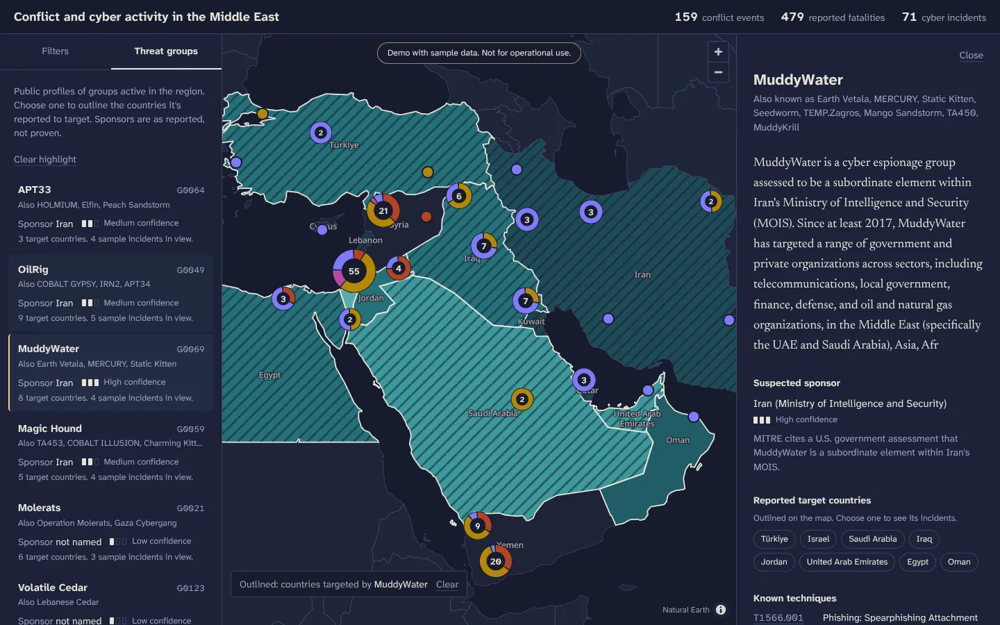
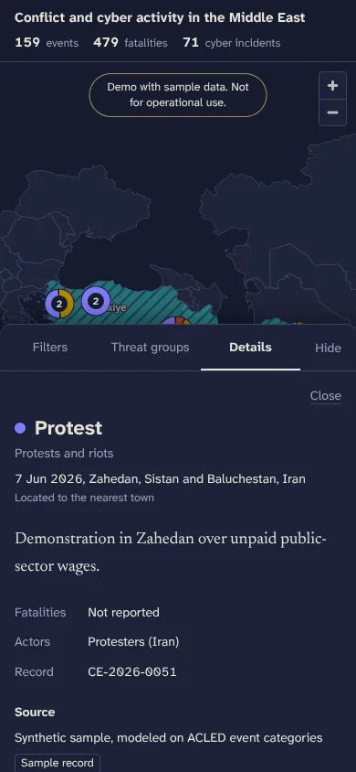

# Conflict and cyber activity in the Middle East

An interactive map that puts two kinds of activity side by side: armed conflict
events as points, and cyber incidents as a choropleth of the countries they
targeted. It's a learning and portfolio project.

> **Demo with sample data. Not for operational use.** The conflict events and
> cyber incidents are generated. Threat group profiles come from MITRE ATT&CK.
> The UI labels every generated record.

<p>
  
  
</p>

The screenshots were taken offline, so they show the fallback basemap (bundled
country shapes only). Online, OpenStreetMap coastlines, province lines and city
names are drawn on top.

## What it does

- **Conflict layer.** Points colored by event family and clustered when they overlap.
  Each cluster is a small donut showing its mix of event types.
- **Cyber layer.** Countries shaded by how many incidents **targeted** them. Where an
  attack came from is never mapped. A hatch marks countries where most incidents
  have no public attribution.
- **Filters.** Month range, country, conflict event types, cyber attack types, and
  a switch for each layer. The stats bar (events, reported fatalities, incidents)
  follows the filters.
- **Details.** Click a point for the event, a country for its events and incidents,
  or a threat group to outline the countries it's reported to target.
- **Uncertainty is visible.** Attribution and sponsorship always show a
  three-step confidence meter with words beside it, and are always worded as
  "suspected". Fatalities with no figure show as "Not reported", never as 0.
- Dark theme, keyboard reachable (markers are real buttons), works down to
  phone width, and respects reduced motion.

## Run it locally

You need Node 20.19 or newer.

```bash
npm install
```

```bash
npm run dev
```

This starts two processes: Vite on <http://localhost:5173> (open this one) and
the API on <http://localhost:3001>. Vite proxies `/api` to the API.

Other scripts:

| Command | What it does |
| --- | --- |
| `npm run build` | Typechecks, then builds the frontend into `dist/` |
| `npm run typecheck` | Typechecks the client, server and scripts |
| `npm run data:validate` | Checks every record in `data/` against the schema |
| `npm run data:generate` | Regenerates the sample events and incidents (seeded, so the output is identical every time) |

## Deploy to Vercel

Import the repo in Vercel and deploy. You don't need to change any settings:
`vercel.json` sets the framework, build command and output folder.

How it fits Vercel's model:

- The frontend is static files in `dist/`, served from Vercel's CDN.
- The API is one serverless function. `api/index.ts` exports the Express app,
  and a rewrite sends every `/api/*` request to it. Express does the routing.
- The data files are **imported**, not read from disk at runtime, so the
  bundler always includes them in the function. API responses are cached at
  the edge for a day, because the data only changes when you deploy.
- Map label fonts are self-hosted in `public/glyphs`. The only third-party
  request at runtime is for OpenFreeMap tiles, and the map still works
  without them.

I checked this with `vercel build`. The compiled function served every
endpoint, and the built site loaded in a browser with the function behind it.

## Project structure

```
api/index.ts            Vercel entry point (re-exports the Express app)
server/
  app.ts                Routes, query validation, caching headers
  dev.ts                Local server on :3001
  sources/
    types.ts            ConflictSource, CyberSource, BoundarySource interfaces
    mockConflict.ts     Reads data/conflict-events.json
    mockCyber.ts        Reads data/cyber-incidents.json + threat-groups.json
    index.ts            Picks implementations. Swap in real sources here
shared/
  constants.ts          Country codes, enums (safe to import in the browser)
  schema.ts             zod schemas and the TypeScript types inferred from them
  filters.ts            Filter logic used by both the API and the browser
data/                   JSON data (see below)
scripts/                Data generator, validator, boundary builder
src/
  map/                  MapLibre style, markers, MapView
  panels/               Filters, threat groups, details, stats, UI parts
  state/appState.ts     Filters, layers, selection
  lib/                  API client, labels and colors, formatting
```

## API

All endpoints return JSON. List endpoints return `{ source, count, data }`.

| Endpoint | Query parameters |
| --- | --- |
| `GET /api/conflicts` | `from`, `to` (YYYY-MM-DD), `types` (comma-separated event types), `countries` (comma-separated ISO codes) |
| `GET /api/conflicts/:id` | |
| `GET /api/cyber/incidents` | `from`, `to`, `attack_types`, `countries`, `group` |
| `GET /api/cyber/groups` | |
| `GET /api/cyber/groups/:id` | |
| `GET /api/countries` | Country polygons (GeoJSON) |
| `GET /api/health` | Which source implementations are active |

Invalid parameters return a `400` that names the problem, for example
`/api/conflicts?types=nope`.

The client loads everything once and filters in the browser with the same
functions the API uses (`shared/filters.ts`). With a large real feed, you'd
send the filters as query parameters instead.

## Data schema

The zod schemas in `shared/schema.ts` are the source of truth. TypeScript
types are inferred from them, and `npm run data:validate` checks the JSON
against them. Every record has a `source`.

### Source reference (on every record)

| Field | Type | Notes |
| --- | --- | --- |
| `name` | string | Who reported it |
| `url` | string? | Link to the report |
| `retrieved` | date? | When it was fetched |
| `synthetic` | boolean | `true` for generated sample data. The UI shows a "Sample record" tag |

### Conflict event (`data/conflict-events.json`)

| Field | Type | Notes |
| --- | --- | --- |
| `id` | string | `CE-YYYY-NNNN` |
| `date` | date | YYYY-MM-DD |
| `lat`, `lng` | number | |
| `country` | ISO 3166 alpha-3 | One of the 17 countries in scope |
| `admin1` | string? | Province or governorate |
| `location_name` | string | Nearest named place |
| `event_type` | enum | `battle`, `airstrike`, `shelling`, `explosion_remote`, `violence_against_civilians`, `protest`, `riot` |
| `actors` | string[] | |
| `fatalities` | integer \| null | `null` means not reported. It is never treated as 0 |
| `location_precision` | enum | `exact`, `town`, `region` |
| `source` | Source reference | |
| `summary` | string | |

On the map, the seven types share four colors, following ACLED's top-level
grouping: battles, explosions and remote violence, violence against civilians,
and protests and riots. Seven hues can't all stay distinguishable on a map,
because any two can end up next to each other. The detail panel always names
the exact type.

### Cyber incident (`data/cyber-incidents.json`)

Incidents are tied to the **target** country. There is deliberately no origin
field: an origin is usually an inference, and a map would make it look like a
fact.

| Field | Type | Notes |
| --- | --- | --- |
| `id` | string | `CI-YYYY-NNNN` |
| `date` | date | |
| `target_country` | ISO alpha-3 | |
| `sector` | enum | `energy`, `government`, `finance`, `telecom`, `water`, `transport`, `health`, `defense`, `media`, `education` |
| `attack_type` | enum | `ransomware`, `wiper`, `ddos`, `espionage`, `defacement`, `supply_chain`, `phishing`, `ics_disruption` |
| `attributed_group` | string \| null | A threat group `id`, or `null` if unattributed |
| `confidence` | `low` \| `medium` \| `high` | Confidence in the **attribution** |
| `attribution_basis` | string | Why it was attributed, in plain words |
| `source` | Source reference | |
| `summary` | string | |

### Threat group (`data/threat-groups.json`)

| Field | Type | Notes |
| --- | --- | --- |
| `id` | string | Slug, e.g. `oilrig` |
| `attack_id` | string \| null | MITRE ATT&CK group ID, e.g. `G0049` |
| `name`, `aliases` | string, string[] | |
| `suspected_sponsor` | `{ value, confidence, note }` | `value` is `null` when no sponsor is named. `note` explains the basis |
| `target_countries` | ISO alpha-3[] | Within the region only |
| `techniques` | `{ id, name }[]` | ATT&CK technique IDs (Enterprise `T1xxx` or ICS `T0xxx`) |
| `techniques_note` | string? | Set when the techniques don't come from ATT&CK |
| `description` | string | |
| `source` | Source reference | |

### Where the sample data comes from

- **Threat groups.** Nine profiles come from MITRE ATT&CK v20: names, aliases,
  descriptions and a selection of each group's mapped techniques. All IDs were
  checked against the official STIX bundle. Target countries and sponsor
  confidence are my reading of the ATT&CK descriptions. A tenth group,
  Predatory Sparrow, has no ATT&CK entry. Its techniques were mapped by hand
  from public reporting, and the profile says so.
- **Conflict events.** 159 generated by `scripts/generate-mock-data.ts`. The
  places and coordinates are real towns. The events are made up. Actors are
  generic ("State forces (Syria)"), so no real party is credited with
  something that didn't happen.
- **Cyber incidents.** 71 generated by the same script. About a third are
  linked to a group whose public profile fits the attack type and target.
  Those links are illustrative, and the validator rejects any generated record
  that claims `high` confidence.
- **Boundaries.** Natural Earth 1:50m admin-0 countries, cut down to the region
  by `scripts/build-countries.py`. They show de facto boundaries and are
  coarse at this scale, especially around Gaza and the West Bank.

## Plugging in a real source

The API only talks to the interfaces in `server/sources/types.ts`:

```ts
interface ConflictSource {
  readonly id: string;
  listEvents(query: ConflictQuery): Promise<ConflictEvent[]>;
  getEvent(id: string): Promise<ConflictEvent | null>;
}

interface CyberSource {
  readonly id: string;
  listIncidents(query: CyberQuery): Promise<CyberIncident[]>;
  listGroups(): Promise<ThreatGroup[]>;
  getGroup(id: string): Promise<ThreatGroup | null>;
}
```

To add one:

1. Write a class that implements the interface, and map the provider's fields
   to the shared types.
2. Register it in `server/sources/index.ts`. Nothing else changes.
3. Put credentials in Vercel environment variables, never in the client.

### Example: ACLED for conflict events

ACLED needs an account and API access. Check
[their API docs](https://acleddata.com/) for the current endpoint and
authentication. This sketch covers only the field mapping, which is the part
that matters here:

```ts
// server/sources/acledConflict.ts
import type { ConflictEvent, CountryCode, EventType } from "../../shared/schema";
import { matchesConflict } from "../../shared/filters";
import type { ConflictQuery, ConflictSource } from "./types";

type AcledRow = {
  event_id_cnty: string; event_date: string; latitude: string; longitude: string;
  iso: string; country: string; admin1: string; location: string;
  event_type: string; sub_event_type: string; actor1: string; actor2: string;
  fatalities: string; geo_precision: string; source: string; notes: string;
};

function eventType(r: AcledRow): EventType | null {
  switch (r.event_type) {
    case "Battles": return "battle";
    case "Violence against civilians": return "violence_against_civilians";
    case "Protests": return "protest";
    case "Riots": return "riot";
    case "Explosions/Remote violence":
      if (r.sub_event_type === "Air/drone strike") return "airstrike";
      if (r.sub_event_type === "Shelling/artillery/missile attack") return "shelling";
      return "explosion_remote";
    default: return null; // e.g. "Strategic developments"
  }
}

export class AcledConflictSource implements ConflictSource {
  readonly id = "acled";
  constructor(private fetchRows: (q: ConflictQuery) => Promise<AcledRow[]>) {}

  async listEvents(query: ConflictQuery) {
    const rows = await this.fetchRows(query);
    return rows.flatMap((r): ConflictEvent[] => {
      const type = eventType(r);
      if (!type) return [];
      return [{
        id: r.event_id_cnty,
        date: r.event_date,
        lat: Number(r.latitude),
        lng: Number(r.longitude),
        country: toAlpha3(r.iso) as CountryCode, // your lookup: ACLED's iso field is numeric
        admin1: r.admin1,
        location_name: r.location,
        event_type: type,
        actors: [r.actor1, r.actor2].filter(Boolean),
        // ACLED generally records 0 when no figure is reported, so "unknown"
        // can't be told apart from a confirmed 0 here.
        fatalities: Number(r.fatalities),
        location_precision: r.geo_precision === "1" ? "town" : "region",
        source: { name: `ACLED (${r.source})`, synthetic: false },
        summary: r.notes,
      }];
    }).filter((e) => matchesConflict(e, query));
  }

  async getEvent(id: string) { /* fetch by event_id_cnty */ return null; }
}
```

Points to watch with real conflict data:

- **GDELT** is machine-coded from news, so it's noisier and full of
  duplicates. Treat its locations as `region` precision, and keep its records
  visibly separate from ACLED's.
- **Licensing.** ACLED's terms limit redistribution. Serve it through the API
  rather than committing raw exports to the repo.
- **Volume.** Thousands of events are fine for clustering. Past that, filter
  on the server (the query parameters already exist) and drop the "load
  everything once" approach in `src/lib/api.ts`.

### Example: MITRE ATT&CK for threat groups

ATT&CK publishes STIX 2.1 bundles at
[`mitre-attack/attack-stix-data`](https://github.com/mitre-attack/attack-stix-data).
Groups are `intrusion-set` objects, techniques are `attack-pattern` objects, and
`relationship` objects with `relationship_type: "uses"` connect them. A
`CyberSource` can load the bundle at build time and return `ThreatGroup`
records. ATT&CK doesn't record sponsors or target countries as fields, so
those stay curated, with a `note` saying where each judgment came from.

There's no free, authoritative feed of cyber **incidents** by target country.
Realistic options are vendor threat reports, CERT advisories, or a hand-kept
log. Whatever you use, keep `attributed_group` null unless a named source
makes the attribution, and record the reason in `attribution_basis`.

## Design notes

- **Color.** Conflict is physical, so it uses warm colors; cyber is digital, so
  it uses one cool hue. The four conflict colors were checked with a
  color-vision-deficiency validator against the land color, across all pairs
  (the right test for a map). The worst pair is ΔE 11.9 under simulated color
  blindness, against a target of 8. The cyber ramp passed an ordinal check:
  lightness increases steadily, it stays within one hue, and its lightest step
  has enough contrast against the land.
- **Type.** Atkinson Hyperlegible Next for the interface, chosen for legibility
  on a dark background. Newsreader, a serif, for event and group summaries, so
  they read like dispatches rather than interface text.
- **Uncertainty.** Three signals carry it: the confidence meter (always with
  words), the underline under a group's name (dotted for low, dashed for
  medium, solid for high), and the hatch on the map.

## Attribution

- Map data © [OpenStreetMap](https://www.openstreetmap.org/copyright)
  contributors, tiles by [OpenFreeMap](https://openfreemap.org) using the
  [OpenMapTiles](https://openmaptiles.org) schema.
- Country boundaries from [Natural Earth](https://www.naturalearthdata.com/)
  (public domain).
- Threat group data from [MITRE ATT&CK®](https://attack.mitre.org/). © The MITRE
  Corporation. This work is reproduced and distributed with the permission of
  The MITRE Corporation.
- Label glyphs (Noto Sans) from
  [protomaps/basemaps-assets](https://github.com/protomaps/basemaps-assets),
  under the SIL Open Font License.
